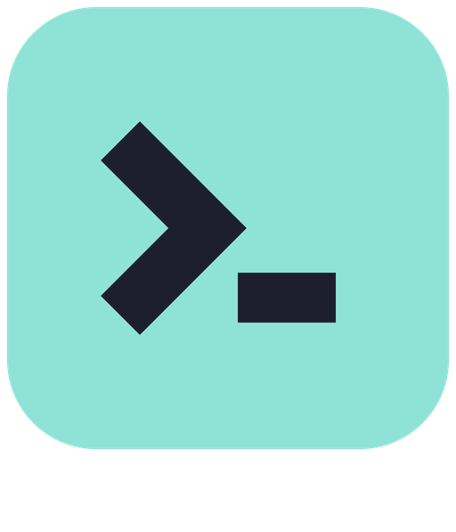
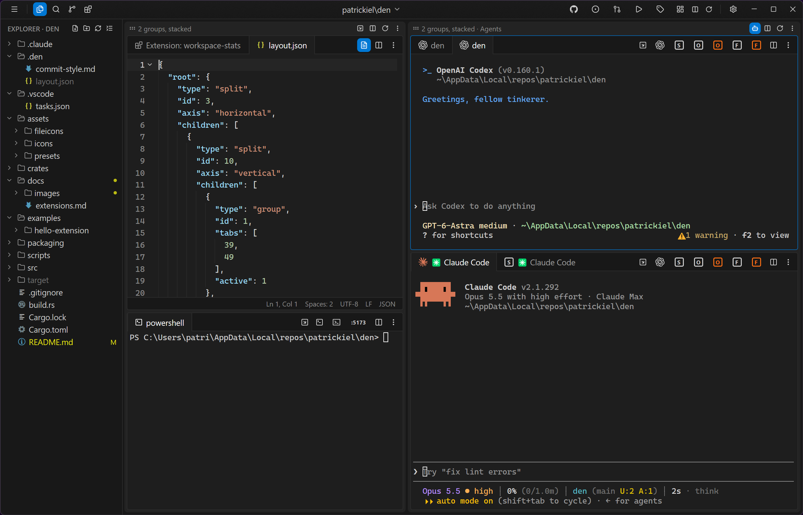

#  den

**Terminals, agents and files in one native window, each exactly where you want it.**

[](https://github.com/patrickiel/den/releases/latest)
[](https://github.com/patrickiel/den/releases/latest)
[](https://www.gpui.rs)



## Why den

In VS Code, terminals are squeezed into a bottom panel and a file opens wherever focus happens to be, often right on top of what you were working on. den lets you decide where everything goes.

- **A layout you design.** Split the window any way you like, then give each area a job: terminals here, files there, agents on the right. Open a file and it lands in the files area, every time. Each project remembers its layout, and you can save your favorites as presets.
- **Several projects in one window.** Each folder is a tab in the title bar, with its own layout, sidebar and terminals; agents keep running in the tabs behind. Move a tab to a window of its own for a second monitor.
- **Native and fast.** Written in Rust on GPUI, the GPU-rendered UI framework behind Zed. No Electron, no web view for the UI.
- **Feels like VS Code.** The same shortcuts, the same command palette (Ctrl+Shift+P) and Quick Open (Ctrl+P), your VS Code color themes, and an Extensions view to add features.
- **Made for coding agents.** Claude Code, Codex or any command is one click away. den marks the tab when an agent finishes or needs your input, and Claude Code and Codex sessions resume after a restart or workspace switch.

## Also included

- **Terminals** for PowerShell, bash, zsh and WSL.
- **Editor** with syntax highlighting, git changes in the gutter and Format Document using your project's own formatter.
- **Your dev server one click away.** A button opens the project's dev server in your browser, its port read from the project itself (`vite.config`, `package.json`, `.env`, `launchSettings.json`, …); link presets open any other page.
- **Explorer, search and source control** with diffs, a commit graph and commit messages written by a local AI model.
- **Automatic updates** from signed releases.

## Install

**Windows:** download `den_<version>_x64-setup.exe` from the [latest release](https://github.com/patrickiel/den/releases/latest) and run it. No admin rights needed.

**macOS (Apple Silicon):** download `den_<version>_aarch64.dmg` from the [latest release](https://github.com/patrickiel/den/releases/latest) and drag den to Applications. It isn't notarized, so the first time right-click `den.app` and choose **Open** (or run `xattr -d com.apple.quarantine /Applications/den.app`).

**Linux (x64; Ubuntu 22.04 or newer):** download `den_<version>_x86_64.tar.gz` from the [latest release](https://github.com/patrickiel/den/releases/latest), then:

```sh
tar -xzf den_*_x86_64.tar.gz
./den/install.sh
```

That puts den in `~/.local/bin` and your applications menu, no root needed. It draws with Vulkan or OpenGL, so it needs the GPU's Mesa or vendor driver (Ubuntu has it), and `unzip` to install extensions.

**WSL:** set the shell in Settings to `wsl`, or just open a folder under `\\wsl.localhost\`, and terminals and git run inside the distribution.

## Extensions

Extensions are Rust crates built on [`den-extension`](crates/den-extension). They can add commands, shortcuts, settings and whole views, and install from the Extensions view by typing `owner/repo`. Start with [`examples/hello-extension`](examples/hello-extension) and the [guide](docs/extensions.md).

## Build from source

Requires stable Rust 1.85+ (MSVC build tools on Windows, Xcode Command Line Tools on macOS). On Ubuntu also:

```sh
sudo apt install build-essential pkg-config libxkbcommon-dev libxkbcommon-x11-dev libxcb1-dev libfontconfig1-dev libfreetype-dev libwayland-dev
```

```powershell
git clone https://github.com/patrickiel/den
cd den
cargo run
```
